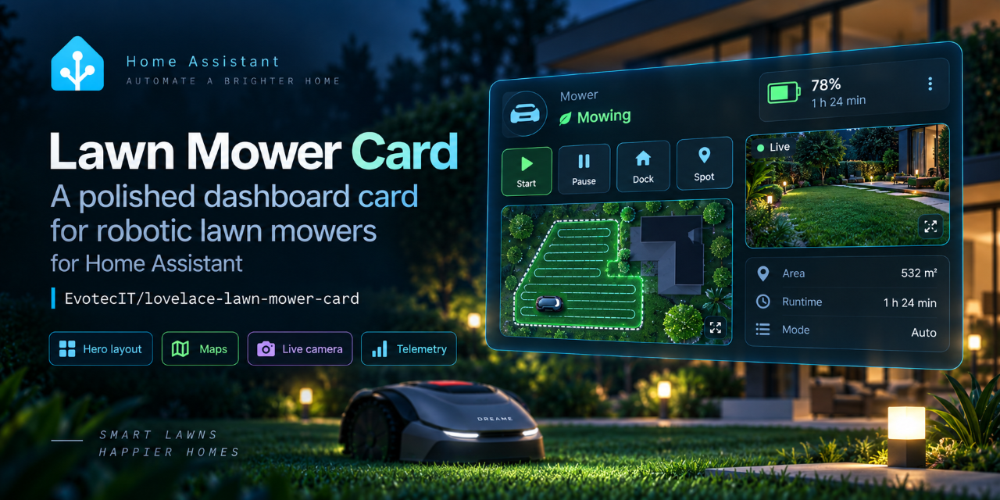
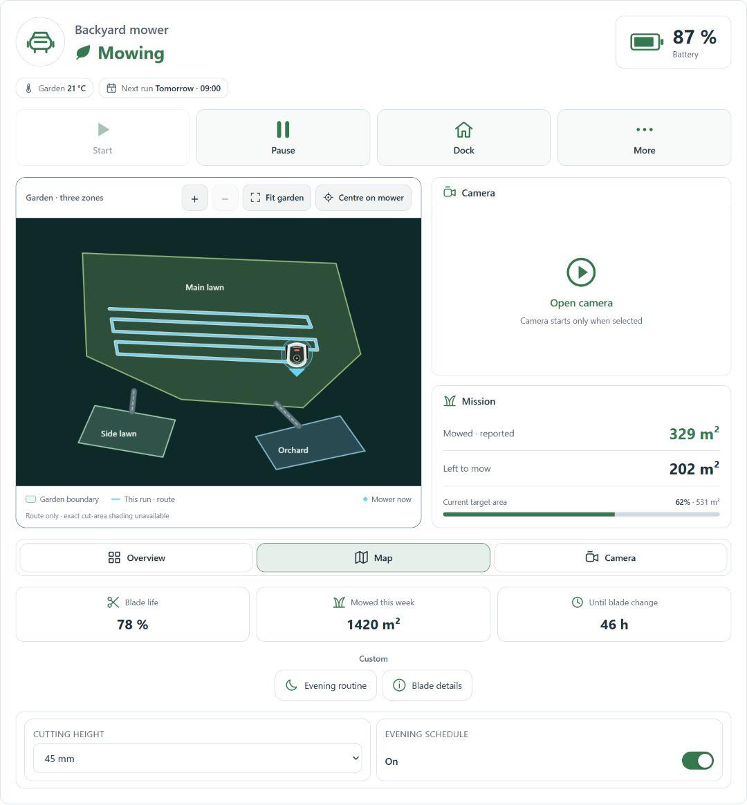
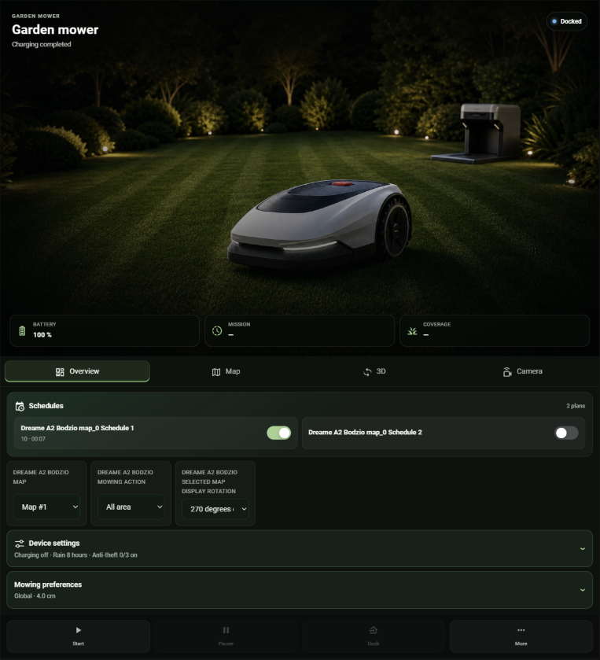
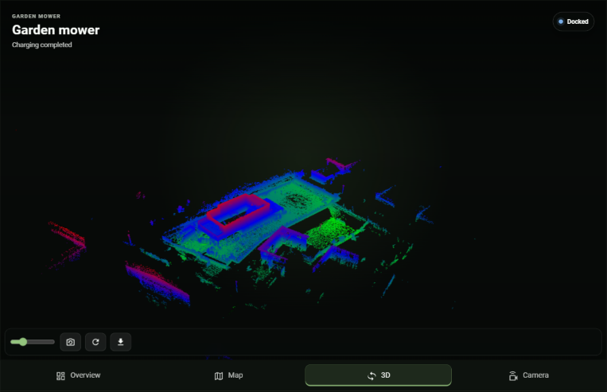
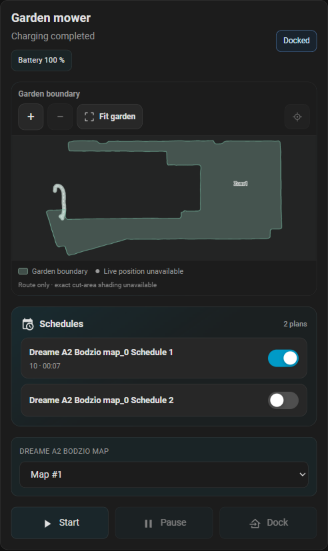
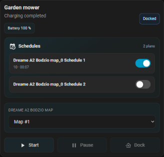

# Lawn Mower Card for Home Assistant



[](https://my.home-assistant.io/redirect/marketplace_repository/?owner=EvotecIT&repository=lovelace-lawn-mower-card&category=plugin)
[](https://github.com/EvotecIT/lovelace-lawn-mower-card/actions/workflows/validate.yml)
[](LICENSE)
[](https://github.com/EvotecIT/lovelace-lawn-mower-card/stargazers)

See your robotic mower at a glance and control it from one card: where it is on
the map, what the camera sees, when it mows next, and how past runs went. Start,
Pause, and Dock are always one tap away.



*The real card, shown with sample mower data. The banner above is artwork. More
layouts, including phone views, are in the [gallery](docs/gallery.md).*

## What you get

- **Works with any Home Assistant lawn mower.** Pick your mower entity and the card
  shows its state, battery, and controls. It works best with the
  [Dreame & MOVA integration](https://github.com/EvotecIT/homeassistant-dreamelawnmower),
  which adds maps, camera, schedules, and history.
- **Live map and camera** when your integration provides them, plus an
  on-demand 3D view of your garden on supported mowers.
- **Week plan and next run** from your mower's schedules, a calendar, or a mowing
  automation.
- **History** of recent runs, when your integration provides it: the map, time,
  and area of each run, with photos and battery use where available.
- **Layouts for every dashboard:** Hero (with an optional Dashboard composition),
  Default, Compact, and Wide, with Native HA, Modern, or Minimal styling. [Add your own](docs/customization.md)
  chips, tiles, and actions.
- **Set up in the visual editor.** No YAML needed. Extra views appear on their
  own when your integration provides them.

Requires **Home Assistant 2025.1.0 or newer**. See
[what your integration needs to expose](docs/integration-compatibility.md).

## Installation

### Home Assistant 2026.11 and newer

[](https://my.home-assistant.io/redirect/marketplace_repository/?owner=EvotecIT&repository=lovelace-lawn-mower-card&category=plugin)

1. Open **Settings → Marketplace** and search for **Lawn Mower Card**.
2. Open the project and select **Install**.
3. Reload your browser, then add **Lawn Mower Card** to your dashboard.

If the project is missing from your catalog, choose **Add from link** and enter
`https://github.com/EvotecIT/lovelace-lawn-mower-card`. Adding a custom repository
requires a GitHub connection.

The Marketplace registers the dashboard resource automatically. If you manage
resources manually, use `/local/community/lovelace-lawn-mower-card/lawn-mower-card.js`
as a JavaScript module. Existing `/hacsfiles/` URLs continue to work.

Existing HACS installations migrate automatically when Home Assistant upgrades
to 2026.11. The repository metadata remains in `hacs.json`.

### Home Assistant 2026.10 and older: HACS

1. Open HACS and search for **Lawn Mower Card** in the dashboard catalog.
2. If it is not listed, add
   `https://github.com/EvotecIT/lovelace-lawn-mower-card` as a custom
   **Dashboard** repository.
3. Install the card and follow any restart or reload prompt from HACS.
4. If HACS does not register the resource automatically, add:

```yaml
url: /hacsfiles/lovelace-lawn-mower-card/lawn-mower-card.js
type: module
```

### Manual

Download `lawn-mower-card.js` from the
[releases](https://github.com/EvotecIT/lovelace-lawn-mower-card/releases),
place it in Home Assistant's `config/www` directory, and add this dashboard
resource:

```yaml
url: /local/lawn-mower-card.js
type: module
```

## Configuration

1. Open a dashboard and choose **Edit dashboard → Add card**.
2. Search for **Lawn Mower Card**, then select your mower entity.
3. Choose a layout and review the detected map, video, and control entities.
4. Save the card. Use the editor to choose companions explicitly if needed.

No YAML is required. A minimal YAML card is also supported:

```yaml
type: custom:lawn-mower-card
entity: lawn_mower.my_mower
layout: hero
```

For the side-by-side map/media and camera composition, select **Hero → Hero
appearance → Composition → Dashboard**, or add `hero_layout: dashboard`.
Narrow cards stack those panels vertically. In **Dashboard side panels**, show
Camera, Mission, both, or neither; `dashboard_panels: []` gives the map the full
card width while keeping the Camera tab available.

For narrow desktop dashboard columns, prefer **Hero**, **Default**, or
**Compact**. The older **Wide** preset has a known container-resizing limitation.

## Documentation

| I want to… | Guide |
| --- | --- |
| See the layouts running in Home Assistant | [Screenshot gallery](docs/gallery.md) |
| Choose a layout, image, or companion entity | [Configuration](docs/configuration.md) |
| Look up a YAML field | [Card options](docs/options.md) |
| Use schedules, settings, zone selection, or advanced panels | [Controls and mowing context](docs/controls.md) |
| Use the map, live video, or 3D viewer | [Maps, video, and 3D](docs/media.md) |
| Check what my integration needs to expose | [Integration compatibility](docs/integration-compatibility.md) |
| Safely try another `custom:lawn-mower-card` or fix a loading conflict | [Card-name conflict troubleshooting](docs/troubleshooting.md) |
| Build, test, or preview the card | [Development](docs/development.md) |

The card displays device-reported mission totals and observed movement. A route
is not proof of cut-area coverage. Mower actions and safety checks remain owned
by the integration; the card does not edit garden geometry or no-go areas.

## Screenshots

### Cinematic Hero



### Real 3D map



### Default and Compact

| Default with map | Compact controls |
| --- | --- |
|  |  |

These captures use a docked mower. The Hero background is customizable; maps,
3D, and optional controls depend on the integration. See the
[gallery](docs/gallery.md) for mobile screenshots and matching YAML.

## Removal

To try another card without deleting your saved card configuration, follow the
[reversible card-switch procedure](docs/troubleshooting.md#can-i-try-this-card-and-then-go-back).

1. For permanent removal, remove the card from each dashboard that uses it.
2. Uninstall **Lawn Mower Card** through **Settings → Marketplace** on HA 2026.11
   or newer, or through HACS on older HA versions. For a manual installation,
   remove its resource declaration and `config/www/lawn-mower-card.js`.
3. Check **Edit dashboard → Manage resources** for an obsolete resource entry.
   YAML-mode resources must be removed where they were declared. Close and
   reopen Home Assistant browser tabs and app windows to unload the module.

Removing this dashboard resource leaves the mower integration and its entities
in place. Saved dashboard cards remain until you delete them; they show a
missing custom element while the resource is absent.

## Support

[Report an issue](https://github.com/EvotecIT/lovelace-lawn-mower-card/issues)
with your card and integration versions, layout, browser, and a minimal card
configuration. Remove private entity names, URLs, and images before posting.
For camera or mower errors, also check the integration's device page and
diagnostics; a failed backend operation may not be a card problem.

## Sponsor

Support development and maintenance through
[GitHub Sponsors](https://github.com/sponsors/PrzemyslawKlys).
Sponsorship is optional; these projects remain open source.

## More for your Home Assistant home

Other integrations and dashboards we maintain:

- [Dreame & MOVA mowers](https://github.com/EvotecIT/homeassistant-dreamelawnmower) — Mowing controls, maps, schedules, and supported cameras.
- [KEF](https://github.com/EvotecIT/homeassistant-kef) — Local control for modern and legacy speaker families.
- [Devialet](https://github.com/EvotecIT/homeassistant-devialet) — Local speaker control, with Dione support.
- [Siegenia](https://github.com/EvotecIT/homeassistant-siegenia) — Local control for supported window controllers.
- [EasyControlX](https://github.com/EvotecIT/homeassistant-easycontrolx) — Connect supported Windows and macOS hosts.
- [Waste Pickup Planner](https://github.com/EvotecIT/lovelace-waste-pickup-planner) — Waste collection dates, bin overviews, cards, and badges.

For a native app connected to the same Home Assistant setup:

- [CasaRay](https://casaray.dev/) — rooms, devices, cameras, and home activity on
  iPhone, iPad, and Mac.
- [Tactra Remote](https://tactra.dev/) — media players, speakers, and TV controls
  on iPhone, iPad, Apple Watch, and Mac.

Neither app is required to use this project.
