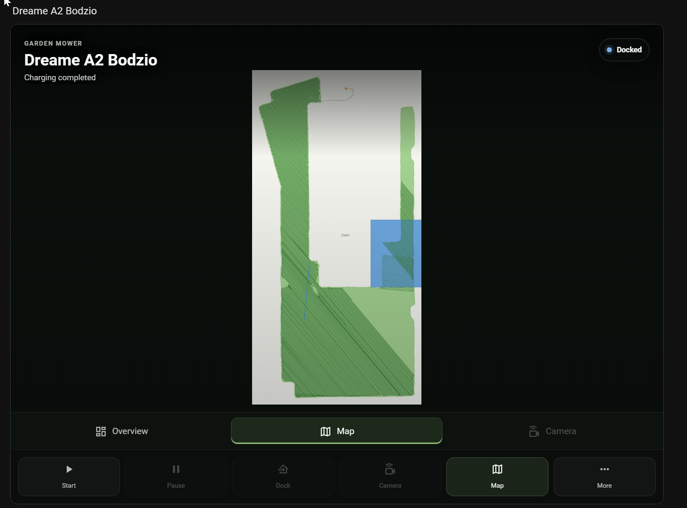

# Maps, video, and 3D

[Back to the README](../README.md) · [Configuration](configuration.md)

## Interactive mowing map

When the selected map camera exposes `mowing_map_api_path`, the Map view supports
dragging, wheel or pinch zoom, **Fit garden**, and **Centre on mower**. Keyboard
users can use the arrow keys, plus/minus, and Home. The garden background stays
loaded while fresh position and current-run movement update separately.

In Hero layout, a mowing session initially opens Map. Choosing another view
overrides that default. Battery, reported current/target area, progress, and mower
controls remain available in the card. Stale live positions are hidden, and the
trail is labelled **Observed movement · not cut-area coverage**; it does not
claim that every enclosed patch has been cut.

A compatible integration may provide a **Last known position**, shown with a
muted marker, or **At dock · observed position** learned from an observed docked pose.
These labels distinguish retained coordinates from **Mower now** and never
restore an old route. **Centre on mower** also works for retained positions.
When docking is confirmed but coordinates are missing, the card says
**Docked · map position unavailable**. Charging alone does not locate the dock.

The optional advanced-details panel and configured sensor tiles can show
**Observed time**, including a **partial** label when the integration missed
part of the session. This separate sensor does not replace device-reported
**Current Mowing Time** or turn an unavailable reported duration into zero.

The visual editor prefers a compatible primary map camera for new automatic
selections. Existing explicit `map_entity` choices are preserved. With the Dreame
integration, choose the primary Map camera to enable this view; an older
integration or a camera without the attribute continues to show its map image.



When the integration also sends the map projection, the mower is drawn at its
real size (`mower_length` × `mower_width`, default 65.9 × 43.9 cm) and turned to
its heading, on every background. It grows with the zoom, which can then go up
to 32×; further out it keeps the fixed icon so it stays visible.
`mower_marker: fixed` always uses the fixed icon.

To show your own mower, put a top-down picture with the nose pointing up in
Home Assistant's `www` folder and set `mower_marker_image: /local/mower/marker.png`.
It takes the place of the built-in mower at the same size and turns with the
heading; if it can't be loaded, the built-in mower is shown.

When the integration lists its zones with label points, the card asks for the
background without names (`labels=0`) and writes the zone names itself: bold,
with a dark halo, at a constant size on every background. A name that would
overlap another one or has no room at the current zoom is hidden until you zoom
in. While aligning, the names follow the mower map.

## Street map and satellite

When the integration describes how its map pixels relate to the mower's own
coordinates (`projection` in the map response), the background picker in the
map toolbar offers **Standard**, **Real scene** (when available), **Map** and
**Satellite**. Map and Satellite draw web-map tiles under the garden map; zones,
the route and the mower stay on top. The picture keeps the mower map's
orientation, so the tiles are turned to match it.

The garden is placed on the ground with a saved alignment (`georeference`).
Without one, choosing Map or Satellite opens **Align** from your Home Assistant
home location (north up, 1 mm per map unit).

**Align** opens full screen. The mower map becomes see-through over the tiles:

- Drag the mower map (one finger or the mouse) to move it; the arrow keys nudge it.
- Drag a **corner handle** to resize it (proportions kept) and the round
  **rotate handle** above the frame to turn it. Handles keep their size on screen.
- Two fingers, the mouse wheel, the **+** and **−** buttons, or dragging outside
  the map only zoom and move the view; they never change the alignment.
- **Align from the base**: drag the map until the base (station) sits on its
  real place, then **Next**; the base is then pinned and pulling any other point
  of the map onto its real place turns and resizes the map about it. Pull as
  many points as needed; **Start over** returns to the first step. When the
  integration has not located the base, press it on the mower map first.
- **Rotation** and **Map size** buttons turn by 0.5° and resize by 0.5%; hold a
  button to repeat faster.
- **Save** sends `dreame_lawn_mower.set_georeference` with the mower entity;
  **Cancel** or Escape keeps the previous alignment.

Alignments belong to a verified mower map and its revision. Switching or
replacing that map closes an open alignment session; reopen Align on the new
map. Each saved map keeps its own alignment. Align is available when the
integration supplies a verified map revision and the calibration action.

The default street map is Esri World Street Map and the default satellite source
is Esri World Imagery. These optional defaults work without a configured API key;
[Esri's access and use constraints](https://doc.arcgis.com/en/arcgis-online/reference/access-use-constraints.htm)
and each service's terms apply. Keep the displayed provider attribution visible.
Where a source has no tiles at a
level, the card steps down to the deepest level it serves and enlarges those
tiles (street map: level 19 at most). Tiles are fetched by your browser from the
provider, which therefore receives your browser's IP and the area being viewed;
requests use the Home Assistant origin as the Referer. Geographic tiles are
requested only while Map or Satellite is selected. The standard mower map
does not contact a tile provider. You can configure another provider URL and
its required attribution in the card options.

OpenStreetMap's own tile servers can be used instead, with their attribution:

```yaml
map_tile_url: https://tile.openstreetmap.org/{z}/{x}/{y}.png
map_tile_attribution: © OpenStreetMap contributors
map_tile_max_zoom: 19
```

Follow the [OpenStreetMap tile usage policy](https://operations.osmfoundation.org/policies/tiles/);
it refuses requests that carry no Referer.

## 3D Point Clouds

The Dreame Lawn Mower integration can provide a 3D point cloud through its Map
camera. A Home Assistant administrator can load it directly in the card.

The download is deliberately on demand:

- in Hero, select the **3D** tab; if support is unverified, read the explanation
  and press **Load 3D map** only when you want to try a generation request
- in compact, default, or wide layouts, choose **3D** in the Map / 3D switch
  above the map; the map and the 3D view share one area, and 3D loads when you
  choose it (or after **Load 3D map** when support is unverified)
- use the viewer to orbit, pan, zoom, change point size, reset, or refresh
- press **PCD** to make a separate signed request for the original file; the
  viewer does not retain the large downloaded source buffer after parsing

An ordinary dashboard render does not generate or fetch garden geometry. The
card never receives the vendor cloud URL or transient object name; it sees only
the integration-owned Home Assistant path. The integration currently limits
this endpoint to Home Assistant administrators, so non-admin users receive an
access message instead of the point cloud.

Larger point clouds first show a preview, then replace it with more detail.
Returning to the Hero 3D tab reuses the same scene and camera view.

While the mower prepares a fresh file, the viewer shows elapsed time and the
integration's normal 45-second generation window. The browser stops a request
after 65 seconds so a broken connection cannot leave the card spinning
indefinitely. Newer integration versions return a privacy-safe problem code,
stage, duration, and retryability flag; the card presents those details with
the next useful action. Older versions still receive the HTTP-status fallback.

The card reads `feature_capabilities.point_cloud` from the integration's map
camera. A request URL, LiDAR, or a 2D map is not proof of 3D export. Unknown
support requires an explicit load; supported mowers keep the existing flow.
Explicitly unsupported exports have no 3D tab. Older integration versions
without this metadata retain their existing on-demand behavior.

If the mower finishes without publishing a fresh file, automatic retries stop.
Check whether the official app offers an actual 3D view for that mower, and
download integration diagnostics before restarting Home Assistant. The 2D map
remains independent of 3D export. Include the visible
`point_cloud_*` reference in the issue report. The card never displays or stores
vendor URLs, transient object names, or point coordinates as troubleshooting
data.

## Photos

With the Dreame & MOVA integration, the Hero layout adds a **Photos** view and
action. It lists the photos the integration saved to Home Assistant media under
`dreame_lawn_mower/<mower>/`, for example patrol photos from
`download_session_photos`. The newest photo is shown large with its capture
time; older photos form an album. Select a photo to view it full size and step
through the album with the arrows or the arrow keys. Photos of a person
detection carry a **Person** badge.

The card reads the folder through Home Assistant's media browser and signs only
the photos on screen, so the album follows the same permissions as **Media**.
It loads only while the view is open and refreshes every two minutes. Set
`show_photos: false` to hide it.

## Media behavior

Unrelated Home Assistant state changes do not redraw the card. Hidden pages
suspend media immediately; a card scrolled off screen gets a 15-second grace
period before suspending. Media resumes when the card is visible again.
Integration-provided restart map images are labelled **Saved preview**, not
**Live**.

Live video starts only when selected. Home Assistant's camera player uses an
available WebRTC provider or falls back to HLS. A snapshot stays behind the
player during startup. Leaving Camera keeps the same player warm for 15 seconds
so a quick return does not restart playback.

## If a view is missing or unavailable

Check that the companion camera is enabled in Home Assistant and selected in
the card editor. A basic mower without map or video entities does not show those
tabs. Check the integration's own camera and diagnostics before treating a
playback error as a card problem.

For narrow desktop dashboard columns, use **Hero**, **Default**, or **Compact**.
The older **Wide** preset currently uses a browser-width breakpoint and can
squeeze its two columns inside a narrow card.
